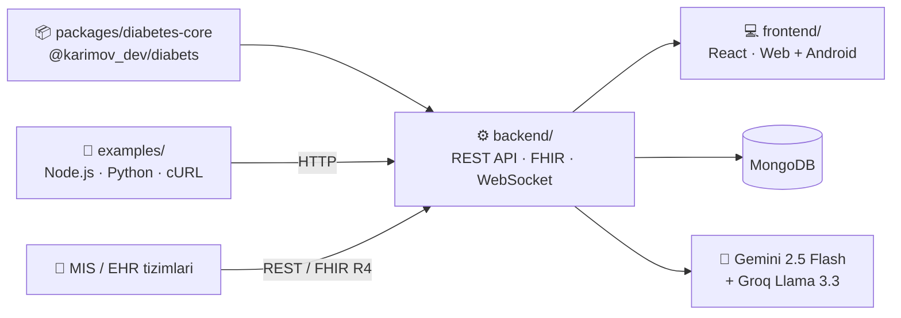

<p align="center">
  
</p>

<p align="center">
  <a href="https://diabetmed.uz"></a>
  <a href="https://www.npmjs.com/package/@karimov_dev/diabets"></a>
  
  
  
  
</p>

<p align="center">
  <b>Qandli diabet bilan kasallangan bemorlar holatini monitoring qilish va asoratlar xavfini baholash uchun<br/>dasturiy kutubxona (SDK), integratsiya interfeyslari va namoyish monitoring tizimi.</b>
</p>

<p align="center">
  <a href="#-loyiha-tarkibi">Tarkibi</a> •
  <a href="#-sdk--diabetes-core">SDK</a> •
  <a href="#-ishga-tushirish">Ishga tushirish</a> •
  <a href="#-funksiyalar">Funksiyalar</a> •
  <a href="#-api-endpointlar">API</a> •
  <a href="#-texnologiyalar">Texnologiyalar</a>
</p>

> [!NOTE]
> **Diplom loyihasi:** Qandli diabet bilan kasallangan bemorlarning holatini monitoring qilish va asoratlar xavfini baholash uchun dasturiy kutubxona va integratsiya interfeyslarini ishlab chiqish.

---

## 🧩 Loyiha tarkibi

Loyiha boshqa dasturchilar va tibbiyot axborot tizimlari (MIS/EHR) uchun **ochiq SDK**, **REST/FHIR integratsiya interfeyslari** hamda amaliy **namoyish monitoring veb-tizimini** o‘z ichiga oladi.



```
smart-monitor/
├── packages/
│   └── diabetes-core/    # ⭐ Dasturiy kutubxona (mustaqil SDK / hisoblash yadrosi)
├── examples/             # ⭐ Boshqa dasturchilar uchun namunalar (Node.js, Python, cURL)
├── backend/              # Integratsiya interfeyslari (REST API, FHIR adapter, WebSocket)
└── frontend/             # Namoyish monitoring tizimi (React + TypeScript + Tailwind, Android)
```

## 📦 SDK — `diabetes-core`

```bash
npm install @karimov_dev/diabets
```

| Modul | Nima qiladi |
|---|---|
| 📊 **Glisemik metrikalar** | TIR / TAR / TBR, CV%, eA1c (Nathan), GMI (Bergenstal 2018) |
| 🩺 **Asoratlar xavfi** | Retinopatiya, nefropatiya, kardiovaskulyar (ASCVD), neyropatiya va diabetik tovon |
| 📋 **FINDRISC** | WHO standarti bo‘yicha 10 yillik 2-tur diabet xavfi |
| 📄 **CGM parser** | FreeStyle Libre, Dexcom va universal glyukometr CSV fayllari |
| 📡 **Qurilma sinxronizatsiyasi** | BLE Glucose Service (`0x1808` / `0x2A18`) va USB Serial dekoderi |
| 💉 **Insulin kalkulyatori** | Bolus / basal: 500-Rule (ICR), 1800/100-Rule (ISF) |
| 🗓 **Glikemik profil** | 6 nuqtali sutkalik profil rejasi va tahlili |
| 📈 **Trendlar** | Chiziqli regressiya (mmol/L/hafta, R²), gipoglikemiya epizodlari |
| 🏥 **HL7 FHIR R4** | `Observation` o‘qish → `RiskAssessment` eksport |
| 🔌 **Integratsiya** | Express router, REST handlerlar, OpenAPI 3.0, real-time monitor, HMAC webhooklar |
| 📑 **Hisobotlar** | Shifokor uchun chop etishga tayyor HTML/PDF xulosa |
| 🌍 **i18n** | O‘zbek, rus, ingliz |

```javascript
const {
  parseGlucoseCSV,
  calculateFINDRISC,
  assessFullDiabetesRisk,
  calculateBolusDose,
} = require('@karimov_dev/diabets');

const records = parseGlucoseCSV(csvDataString);
const risk = assessFullDiabetesRisk(profile, records);
```

To‘liq API va misollar: **[packages/diabetes-core/README.md](./packages/diabetes-core/README.md)** · Integratsiya namunalari: **[examples/](./examples)**

## 🚀 Ishga tushirish

**1. MongoDB** — mahalliy o‘rnating yoki [MongoDB Atlas](https://www.mongodb.com/atlas) dan foydalaning.

**2. Backend**

```bash
cd backend
npm install
cp .env.example .env   # .env faylini tahrirlang (pastda tushuntirish bor)
npm run dev
```

**3. Frontend**

```bash
cd frontend
npm install
npm run dev
```

| Xizmat | Manzil |
|---|---|
| Frontend | http://localhost:5173 |
| Backend | http://localhost:5000 |

> Ikkalasini birga ishga tushirish: ildiz papkada `npm run install:all`, so‘ng `npm run dev`.

<details>
<summary><b>⚙️ <code>backend/.env</code> sozlamalari</b></summary>

```env
PORT=5000
MONGODB_URI=mongodb://localhost:27017/diabetes_db

# JWT (o'zgartiring!)
JWT_SECRET=your_super_secret_jwt_key
JWT_EXPIRES_IN=7d
JWT_REFRESH_SECRET=your_refresh_secret
JWT_REFRESH_EXPIRES_IN=30d

# Email (Gmail App Password)
EMAIL_HOST=smtp.gmail.com
EMAIL_PORT=587
EMAIL_USER=sizning_email@gmail.com
EMAIL_PASS=gmail_app_password   # Gmail > Sozlamalar > 2FA > App passwords
EMAIL_FROM=noreply@diabetesapp.uz

# Google OAuth (console.cloud.google.com)
GOOGLE_CLIENT_ID=your_google_client_id
GOOGLE_CLIENT_SECRET=your_google_client_secret
GOOGLE_CALLBACK_URL=http://localhost:5000/api/auth/google/callback

# Facebook OAuth (developers.facebook.com)
FACEBOOK_APP_ID=your_facebook_app_id
FACEBOOK_APP_SECRET=your_facebook_app_secret
FACEBOOK_CALLBACK_URL=http://localhost:5000/api/auth/facebook/callback

FRONTEND_URL=http://localhost:5173

# Gemini AI (aistudio.google.com) - Asosiy Agent LLM
GEMINI_API_KEY=your_gemini_api_key

# Groq Cloud (console.groq.com) - Zaxira Agent LLM (Llama 3.3 70B)
GROQ_API_KEY=your_groq_api_key

# Super Admin (birinchi ishga tushganda avtomatik yaratiladi)
SUPER_ADMIN_EMAIL=admin@diabetesapp.uz
SUPER_ADMIN_PASSWORD=SuperAdmin123!
```

</details>

## 🔑 Funksiyalar

<table>
<tr>
<td width="50%" valign="top">

### 🔐 Autentifikatsiya
- Email + parol bilan ro‘yxatdan o‘tish
- Email OTP tasdiqlash (6 xonali kod)
- Parol yoki email OTP bilan (parolsiz) kirish
- Google va Facebook OAuth
- Parolni tiklash
- JWT access + refresh token, avtomatik yangilash

### 👤 Foydalanuvchi profili
- Ism, familiya, telefon, tug‘ilgan sana, jins
- **Viloyat** (O‘zbekistonning 14 hududi) va **tuman/shahar**
- Diabet turi: 1-tip, 2-tip, prediabet, homiladorlik, yo‘q
- Shifokor ismi

### 🩸 Qon shakari
- Yozuv qo‘shish (och qoringa, ovqatdan keyin)
- Tarix, statistika va maslahatlar

</td>
<td width="50%" valign="top">

### 🛡 Super admin paneli
- Dashboard: jami, aktiv va bloklangan foydalanuvchilar
- Viloyatlar va diabet turlari bo‘yicha statistika
- Foydalanuvchilarni qidirish, filtrlash, yozuvlarini ko‘rish
- Bloklash, rol o‘zgartirish (user / doctor / superadmin)
- Admin eslatmalari, foydalanuvchini o‘chirish

### 🤖 AI agent (Gemini 2.5 Flash + Groq Llama 3.3 70B)
- Barcha sahifalarda suzuvchi AI maslahatchi
- Agentic loop va tool calling:
  `get_recent_blood_sugar` · `get_user_profile` · `get_nutrition_advice` · `alert_doctor`
- Kritik qand holatida shifokorga real-time ogohlantirish (Socket.io) + AuditLog
- Gemini birlamchi, Groq zaxira provayder
- Ko‘p bosqichli suhbat xotirasi, uz/ru/en javoblar
- Rate limiting: foydalanuvchiga 20 so‘rov/daqiqa

### 🎨 UI/UX
- Dark / Light rejim · 3 til · to‘liq responsive
- Android ilova (Capacitor) va PWA

</td>
</tr>
</table>

## 🔒 API endpointlar

<details>
<summary><b>Auth</b></summary>

```
POST /api/auth/register          - Ro'yxatdan o'tish
POST /api/auth/verify-otp        - Email OTP tasdiqlash
POST /api/auth/login             - Kirish (parol)
POST /api/auth/email-login       - Kirish (email OTP)
POST /api/auth/forgot-password   - Parolni tiklash so'rovi
POST /api/auth/reset-password    - Yangi parol o'rnatish
POST /api/auth/refresh-token     - Token yangilash
GET  /api/auth/me                - Mening ma'lumotlarim
POST /api/auth/logout            - Chiqish
POST /api/auth/complete-profile  - Profilni to'ldirish
GET  /api/auth/google            - Google bilan kirish
GET  /api/auth/facebook          - Facebook bilan kirish
```

</details>

<details>
<summary><b>Qon shakari</b></summary>

```
GET    /api/blood-sugar          - Yozuvlar ro'yxati
POST   /api/blood-sugar          - Yangi yozuv
GET    /api/blood-sugar/stats    - Statistika
PUT    /api/blood-sugar/:id      - Yozuvni yangilash
DELETE /api/blood-sugar/:id      - Yozuvni o'chirish
```

</details>

<details>
<summary><b>Admin (faqat superadmin)</b></summary>

```
GET    /api/admin/stats              - Dashboard statistika
GET    /api/admin/users              - Barcha foydalanuvchilar
GET    /api/admin/users/:id          - Bitta foydalanuvchi
GET    /api/admin/users/:id/records  - Foydalanuvchi yozuvlari
PATCH  /api/admin/users/:id/role     - Rolni o'zgartirish
PATCH  /api/admin/users/:id/ban      - Ban / unban
PATCH  /api/admin/users/:id/notes    - Admin eslatmasi
DELETE /api/admin/users/:id          - O'chirish
```

</details>

<details>
<summary><b>AI agent</b></summary>

```
POST /api/ai/agent      - AI Agent bilan suhbat (Tool-calling, Gemini + Groq)
POST /api/ai/chat       - Oddiy AI chat
POST /api/ai/analyze    - Statistikani tahlil qilish
```

</details>

## 📦 Texnologiyalar

<p>
  
</p>

| Qatlam | Texnologiyalar |
|---|---|
| **Backend** | Node.js, Express, MongoDB + Mongoose, JWT, Socket.io, Passport.js (Google/Facebook), Nodemailer / Resend, bcryptjs, express-rate-limit |
| **Frontend** | React 18, TypeScript, React Router v6, Axios, MUI + Tailwind CSS, Framer Motion, Recharts, Sonner, Capacitor (Android) |
| **AI** | Google Gemini 2.5 Flash (`@google/generative-ai`) — asosiy tool-calling agent · Groq Cloud `llama-3.3-70b-versatile` — zaxira |
| **Standartlar** | ADA tavsiyalari, WHO FINDRISC, HL7 FHIR R4, OpenAPI 3.0 |

---

> [!IMPORTANT]
> Ushbu tizim tibbiy qaror qabul qilish uchun yordamchi vosita. Davolash bo‘yicha yakuniy qarorlar shifokor tomonidan qabul qilinadi.

<p align="center">
  Muallif: <a href="https://github.com/Karimov10112"><b>Azamatjon Karimov</b></a> · <a href="https://diabetmed.uz">diabetmed.uz</a> · <a href="https://www.npmjs.com/package/@karimov_dev/diabets">npm</a>
</p>
